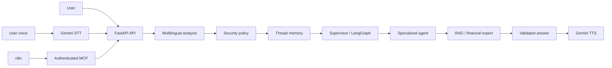

# EduBourse Runtime Architecture

## Request Paths



## Ownership

- FastAPI and LangGraph own language, security, memory, routing, agents, RAG and grounding.
- n8n validates the shape of `message` and `thread_id` and calls MCP only.
- MCP delegates to `/api/v1/chat` and has no conversation memory.
- n8n has no conversation memory.
- The backend owns current-thread continuity through the caller-provided `thread_id`.
- n8n and MCP do not select agents or inject route, language or RAG state.

## Routes

The supported backend routes are:

- `pedagogie`: financial education, concepts and instruments; grounded RAG.
- `formation_elearning`: Ecole de la Bourse training and e-learning information.
- `cisi`: CISI-related training and certification information.
- `quiz`: educational quizzes.
- `championnat`: Championnat de la Bourse and e-Bourse educational support.
- `orientation`: training and learning-path guidance.
- `support_ecole`: practical Ecole de la Bourse service support.
- `securite`: sensitive personalized-investment requests and educational safety.
- `out_of_domain`: requests outside the authorized financial-education domain.
- `fallback`: safe response when no specialized route is applicable.

## Multilingual Processing

Business languages are `fr`, `en`, `ar` and `ary`. Moroccan Darija is
supported in Arabic script and Latin transliteration. Internal detector labels
may be `ary-arabic` and `ary-latin`, while normalized business language stays
`ary`. Arabic/Darija acceptance tests must use a Python UTF-8 JSON client.

## Grounded RAG

The local BGE-M3 index is `j6_bge_m3_content_v1`, containing 353 vectors of
dimension 1024. The current user input is the base retrieval query. The
existing query-adaptation layer may create an adapted retrieval query for a
language or path; it does not own business routing or language normalization.
Evidence remains restricted to the approved corpus. Retrieval is followed by
strict provider-output, evidence-ID, script and citation validation. The
pipeline fails closed on provider or grounding errors.

## Docker Networks and Frontend Contract

Create the exact external networks before first use:

```powershell
docker network create financial-education-assistant_mcp_backend_network
docker network create financial-education-assistant_n8n_backend_network
```

The MCP network connects MCP to the backend. The n8n network connects n8n to
the backend/MCP integration. This reachability is transport plumbing, not a
business capability.

The future frontend sends `message` and `thread_id` to
`POST /api/v1/chat`, then renders the existing response contract. Voice uses
the voice API, Gemini STT, the same canonical backend pipeline and Gemini TTS.
The frontend must not select agents, call ChromaDB or PostgreSQL directly,
bypass Security or duplicate LangGraph routing.

## Persistence Ownership

PostgreSQL remains available as application infrastructure and future
persistence capability. In the current demo, `PERSISTENCE_ENABLED=false` and
`MemorySaver` owns in-process conversational continuity. Chat memory is not
durable across backend restarts.

## Resource Constraints

The supported local stack is backend, PostgreSQL, ChromaDB, MCP and n8n. The
machine has 8 GB RAM and Docker has approximately 3.8 GiB available. BGE-M3
is memory intensive, so frontend, pgAdmin and legacy services should remain
stopped during the demo.
