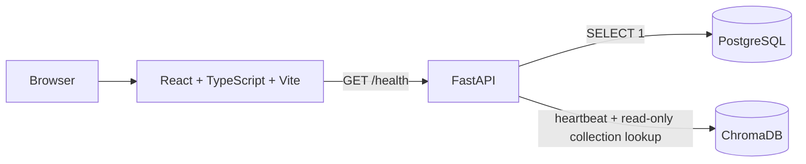

# Architecture

This project is a clean technical foundation for a future financial education assistant.

## Current Scope

- HTTP API bootstrapping
- Centralized configuration
- Structured logging with request IDs
- PostgreSQL connectivity
- ChromaDB connectivity without mutating health checks
- Separate liveness and dependency health endpoints
- Frontend status dashboard
- Docker Compose orchestration
- Backend tests and CI

## Explicitly Out Of Scope

- Business agents
- Domain RAG
- Crawlers
- Market logic
- n8n workflows
- MCP integrations
- Paid voice providers
